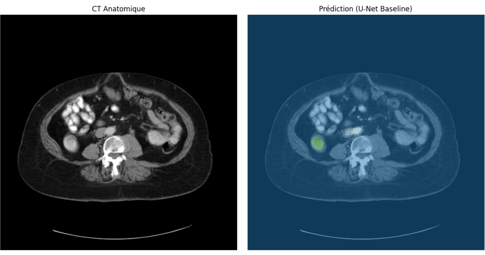
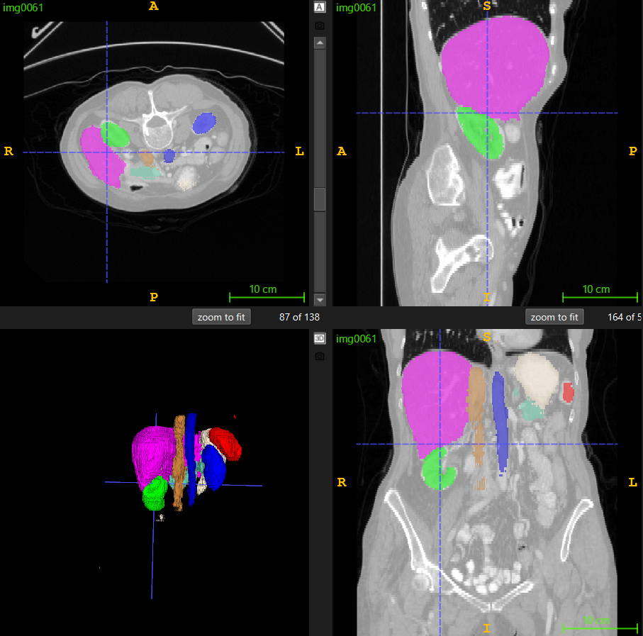

# 🫀 3D Organ Mapper : Segmentation Multi-Organes par Deep Learning


[](https://github.com/zmoy/organ-mapper/actions/workflows/tests.yml)

## 📌 Contexte Clinique
La segmentation automatique des organes sur des scanners 3D (CT scans) est un enjeu majeur en imagerie médicale. Elle permet de :
* **Planifier la radiothérapie** en protégeant les organes sains (Organ-At-Risk).
* **Préparer les interventions chirurgicales** en offrant une cartographie 3D précise au chirurgien.
* **Accélérer le flux de travail** des radiologues en automatisant le détourage manuel.

Ce projet vise à développer un pipeline MLOps complet capable de segmenter simultanément **14 organes de l'abdomen** à partir de volumes CT bruts, en comparant une approche classique (U-Net) avec l'état de l'art des Vision Transformers (Swin UNETR).

---

## ⚙️ Pipeline de Données (MONAI)
Contrairement aux images 2D classiques (RGB), l'imagerie médicale 3D nécessite un pré-traitement rigoureux respectant la physique de l'acquisition. Ce projet utilise la librairie **MONAI** pour garantir l'intégrité clinique des données :

* **`Orientationd (axcodes="RAS")`** : Standardisation de l'orientation anatomique (Right, Anterior, Superior) pour tous les patients.
* **`Spacingd (1.5, 1.5, 2.0 mm)`** : Rééchantillonnage isométrique pour que le modèle apprenne la "vraie" taille physique des organes.
* **`ScaleIntensityRanged`** : Application d'un *Windowing* basé sur les Unités Hounsfield (HU) de l'abdomen, borné entre -175 (air) et 250 (os).
* **`RandCropByLabelClassesd`** : Extraction dynamique de patchs 3D **équilibrés par classe** (les petits organes sont tirés plus souvent que les gros) pour gérer le déséquilibre anatomique et optimiser la VRAM. L'option `--sampling posneg` revient à l'échantillonnage organe / fond (`RandCropByPosNegLabeld`).
* **Cache disque (`PersistentDataset`)** : le prétraitement déterministe (chargement, orientation, spacing, fenêtrage) est calculé une seule fois (environ 60 fois plus rapide ensuite).

---

## 🛠️ Défis d'Ingénierie & MLOps (Contrainte : 4 Go VRAM)
L'entraînement de modèles 3D massifs est notoirement coûteux en mémoire. Pour faire tourner un Transformer State-of-the-Art de 62 millions de paramètres sur une configuration locale limitée à 4 Go de VRAM et une RAM système restreinte, plusieurs stratégies ont été implémentées :

1. **CPU Offloading & Métriques ciblées :** Déplacement des tenseurs de validation sur la RAM hôte et suppression du calcul de la *Validation Loss* géante au profit du *Dice Score* calculé via des tenseurs `one_hot` optimisés.
2. **Gradient Accumulation :** Réduction du `batch_size` effectif à 1 avec accumulation des gradients sur 8 itérations pour simuler un grand batch size sans exploser la VRAM.
3. **Patch-based Validation :** Abandon du *Sliding Window Inference* global en phase de validation au profit d'une évaluation par patchs pour prévenir les erreurs d'allocation système (`alloc_cpu.cpp OOM`).

4. **Entraînement reprenable :** Ctrl+C arrête proprement à la fin de l'epoch (`last.ckpt`), et `--resume` reprend là où l'entraînement s'est arrêté (les folds terminés sont sautés).
5. **Évaluation économe en RAM :** Dice, HD95 et NSD calculés organe par organe sur des masques `uint8`.

Les expériences peuvent être trackées sur **Weights & Biases** (ou en CSV avec `--logger csv`).

---

## 📊 Expériences & Résultats

Les modèles sont entraînés sur un jeu très restreint (24 images d'entraînement, 6 de validation par fold) pour observer leur comportement en régime "Low-Data". Toutes les métriques sont calculées sur **volumes entiers** (sliding window) et moyennées sur les 13 organes :
* **Dice** : recouvrement volumique.
* **HD95** en millimètres (spacing 1.5 × 1.5 × 2.0 mm) : 95e percentile de la distance entre les contours prédit et réel.
* **NSD** (*Normalized Surface Distance*, tolérance 2 mm) : part du contour placée à moins de 2 mm du contour réel, recommandée par *Metrics Reloaded* pour les petites structures.
* Un organe **jamais prédit** compte la pire valeur possible : HD95 = diagonale du volume (~700 mm) et NSD = 0. C'est pourquoi un seul organe manqué fait exploser le HD95 moyen.

### U-Net : de la baseline à la validation croisée

| Modèle | Protocole | Dice | HD95 (mm) | NSD |
| :--- | :--- | :--- | :--- | :--- |
| U-Net baseline (4.8 M) | hold-out, 6 volumes | 0.439 | 336.5 | 0.315 |
| U-Net, DiceCE + patchs par classe + cosinus, 250 epochs + post-traitement | CV 5 folds | 0.567 ± 0.018 | 133.2 ± 8.9 | 0.455 ± 0.010 |
| idem + loss pondérée sur les petits organes (`--rare-loss-weight 5`) | CV 5 folds | 0.666 ± 0.027 | 23.7 ± 5.6 | 0.565 ± 0.026 |
| idem + inférence gaussienne, recouvrement 75 % | CV 5 folds | 0.700 ± 0.030 | 21.8 ± 6.4 | 0.610 ± 0.030 |
| idem + augmentations fortes (`--augmentation strong`) | **CV 5 folds** | **0.719 ± 0.022** | **19.3 ± 4.6** | **0.630 ± 0.021** |

Les trois premières lignes utilisent l'inférence d'origine : patchs moyennés uniformément, avec 50 % de recouvrement.

Organes manqués : 5 sur 13 pour la baseline (organes 4, 5, 10, 12 et 13), 2 sur 13 sans la loss pondérée (organes 12 et 13, sur les 5 folds), aucun avec. Avec les augmentations fortes, la surrénale gauche (organe 13) est manquée sur un seul volume du fold 1 avec le meilleur checkpoint, et sur aucun avec le dernier.

Effet des augmentations fortes (rotations ±15°, mise à l'échelle ±15 %, bruit, flou, luminosité, contraste gamma, sans retournement), un seul paramètre changé :

| Fold | Dice sans → avec | HD95 (mm) sans → avec | NSD sans → avec |
| :--- | :--- | :--- | :--- |
| 1 | 0.678 → 0.694 | 24.5 → 27.3 | 0.589 → 0.608 |
| 2 | 0.730 → 0.742 | 17.5 → 17.9 | 0.624 → 0.642 |
| 3 | 0.669 → 0.709 | 31.9 → 17.2 | 0.576 → 0.612 |
| 4 | 0.733 → 0.741 | 16.6 → 16.0 | 0.652 → 0.658 |
| 5 | 0.690 → 0.707 | 18.4 → 17.8 | 0.609 → 0.628 |

* **Le Dice et le NSD progressent sur les 5 folds** (+1.9 et +2.0 points en moyenne), et l'écart-type entre folds diminue. Les gains les plus nets concernent la rate (0.80 → 0.86, qui ne se fragmente plus sur le fold 3), la vésicule (0.52 → 0.56), la veine porte (0.60 → 0.63), le pancréas (0.57 → 0.61) et l'estomac (0.71 → 0.73).
* **HD95 :** il baisse en moyenne (21.8 → 19.3 mm), surtout grâce au fold 3. Sur le fold 1, la surrénale gauche manquée sur un volume pèse lourd (HD95 de l'organe 13 : 140 mm sur ce fold).

Effet de la loss pondérée sur les petits organes (Dice moyen sur les 5 folds, avec post-traitement) :

| Organe | sans pondération | avec pondération ×5 |
| :--- | :--- | :--- |
| 4 | 0.152 | **0.480** |
| 5 | 0.544 | **0.627** |
| 10 | 0.478 | **0.571** |
| 12 | 0.000 | **0.453** |
| 13 | 0.000 | **0.489** |

* **Loss pondérée (`--rare-loss-weight 5`) :** les organes 12 et 13 sont désormais détectés sur les 5 folds et l'organe 4 triple son Dice. Les gros organes reculent légèrement (organe 2 : 0.83 → 0.79, organe 11 : 0.53 → 0.48), mais le Dice moyen gagne 10 points et le HD95 est divisé par 5.6.
* **Post-traitement :** conservation de la plus grande composante connectée de chaque organe. Il supprime les fausses détections lointaines : mesuré sur la CV sans pondération, il divisait par plus de deux le HD95 des organes détectés, sans dégrader le Dice.
* **Ce qui a vraiment fait la différence :** l'échantillonnage de patchs par classe (+16 points de Dice sur le fold 1), une durée d'entraînement suffisante (250 epochs, la courbe de Dice reste plate pendant ~60 epochs avant de décoller), puis la pondération de la loss.

### Réglages de l'inférence (sans réentraînement)

Mêmes modèles (meilleur checkpoint de chaque fold, loss pondérée), avec post-traitement ; un seul réglage changé à chaque ligne :

| Inférence | Dice | HD95 (mm) | NSD | Temps (30 volumes) |
| :--- | :--- | :--- | :--- | :--- |
| Patchs moyennés uniformément, recouvrement 50 % | 0.666 ± 0.027 | 23.7 ± 5.6 | 0.565 ± 0.026 | ~20 min |
| Pondération gaussienne, recouvrement 50 % | 0.692 ± 0.025 | 22.4 ± 5.5 | 0.598 ± 0.027 | ~20 min |
| **Pondération gaussienne, recouvrement 75 %** (défaut) | **0.700 ± 0.030** | **21.8 ± 6.4** | **0.610 ± 0.030** | ~55 min |
| idem + TTA par retournements (8 versions) | 0.085 ± 0.014 | 378.3 ± 18.9 | 0.040 ± 0.008 | ~6 h |

* **Pondération gaussienne :** là où les patchs se chevauchent, le centre de chaque patch compte davantage que ses bords, où le réseau voit moins de contexte. C'est le gain le plus net : +2.6 points de Dice, sur les 5 folds.
* **Recouvrement 75 % :** +0.8 point de Dice, sur les 5 folds également, pour un temps de calcul presque triplé (`--sw-overlap 0.5` reste disponible).
* **TTA par retournements :** elle effondre les scores. Le modèle n'a jamais vu de scanner retourné à l'entraînement et l'anatomie abdominale n'est pas symétrique (foie à droite, rate à gauche). Sur un volume, chaque version retournée obtient un Dice de 0.01 à 0.19 contre 0.56 pour l'original, et la moyenne est dominée par ces 7 prédictions fausses. nnU-Net peut l'utiliser parce qu'il entraîne avec des retournements aléatoires. L'option `--tta` est conservée pour un futur modèle entraîné ainsi.

### ⚠️ Limites méthodologiques

* **Réglages choisis sur le fold 1 :** l'échantillonnage, les poids de classes et la durée d'entraînement ont été réglés en regardant la validation du fold 1. Ses 6 volumes ont donc servi à la fois au réglage et à l'évaluation, et son score est optimiste. Les 4 autres folds n'ont pas servi au réglage : leur Dice moyen avec la loss pondérée (0.672) est proche de celui du fold 1 (0.640), ce qui suggère que ce biais reste faible.
* **Sélection du checkpoint :** chaque fold est évalué avec son meilleur checkpoint (Dice maximal sur sa propre validation), ce qui biaise légèrement les scores à la hausse. Mesuré sur l'entraînement avec augmentations fortes (`evaluate.py --checkpoint-kind last`), le biais est faible : le dernier checkpoint (epoch 250, sans sélection) obtient 0.715 ± 0.025 de Dice, 19.2 ± 3.3 mm de HD95 et 0.629 ± 0.024 de NSD, contre 0.719 / 19.3 / 0.630 pour le meilleur. Pour les entraînements précédents, `last.ckpt` était une copie du meilleur checkpoint (comportement de `save_last` dans Lightning 2.x, corrigé depuis) et l'écart n'a pas pu être mesuré.
* **Réglages d'inférence choisis sur la validation croisée :** la pondération gaussienne et le recouvrement ont été retenus en regardant les mêmes 30 volumes. Le biais est faible, car ce sont deux réglages standards et le gain apparaît sur chacun des 5 folds.
* **Pas de jeu de test indépendant :** les 30 volumes annotés servent tous à la validation croisée ; les images de `imagesTs` n'ont pas d'annotation.

### Comparaison avec Swin UNETR

| Modèle | Paramètres | Architecture | Dice Score (Val) |
| :--- | :--- | :--- | :--- |
| **U-Net (baseline)** | 4.8 M | Convolutions (CNN) | **~ 44 %** |
| **Swin UNETR (SOTA)** | 62.2 M | Vision Transformer | ~ 8 % (Plafond à 20%) |

L'expérience prouve une règle fondamentale du Deep Learning : **le biais inductif face au besoin de données**.
Le **U-Net**, grâce à la nature de ses convolutions, comprend nativement la contiguïté spatiale (les pixels voisins forment des bords). Il parvient à extraire des caractéristiques pertinentes même avec 24 images.
À l'inverse, le **Swin UNETR**, dépourvu de ce biais inductif, utilise des mécanismes d'Attention qui nécessitent des milliers d'exemples pour "comprendre" l'image. En l'absence de *Pre-training* massif, ses 62 millions de paramètres ont sévèrement sur-appris (*overfitting*) sur le set d'entraînement. *(Ces essais Swin UNETR datent de la baseline et n'ont pas été refaits avec les améliorations ci-dessus.)*

---

## 👁️ Visualisation des Inférences
Le script d'inférence intègre la transformation `Invertd` de MONAI pour replacer les prédictions 3D exactement dans l'espace physique original du patient (512x512).

### Surcouche Anatomique (Coupe Axiale)
> *À gauche : Le scanner CT brut. À droite : La prédiction 3D du U-Net Baseline superposée.*



### Rendu 3D (ITK-SNAP)
> *Modélisation 3D des organes segmentés par l'IA sur un set de test aveugle.*



---

## 🚀 Utilisation & Reproductibilité

**1. Installation des dépendances :**

```bash
pip install -r requirements.txt
```

**2. Lancement de l'entraînement :**
Tous les réglages (modèle, loss, patchs, scheduler...) se passent en ligne de commande (`python scripts/train.py --help`). Les valeurs par défaut sont celles de la configuration de référence, en validation croisée 5 folds :

```bash
python scripts/train_cv.py --run-name <nom> --logger csv
# équivalent explicite (run cv_classes_w5_aug) :
python scripts/train_cv.py --run-name cv_classes_w5_aug --logger csv --max-epochs 250   --lr-scheduler cosine --warmup-epochs 5 --loss dicece --num-samples 4 --batch-size 2   --sampling classes --rare-weight 3 --rare-loss-weight 5 --augmentation strong
```

Les réglages des essais antérieurs se retrouvent avec les options (docstring de `src/training/config.py`).

Ctrl+C arrête proprement à la fin de l'epoch ; la même commande avec `--resume` reprend l'entraînement. Si l'espace libre du disque passe sous 2 Go (`--min-free-gb`), l'entraînement refuse de démarrer, ou s'arrête proprement en fin d'epoch avec un code d'erreur : il suffit de libérer de la place puis de relancer avec `--resume`.

**3. Évaluation en volume entier (Dice, HD95 en mm, NSD) :**

```bash
python scripts/evaluate.py --cv --checkpoints-dir checkpoints/cv_classes_w5 --postprocess
```

Ajouter `--checkpoint-kind last` pour évaluer le dernier checkpoint de chaque fold au lieu du meilleur. L'inférence utilise par défaut la pondération gaussienne avec 75 % de recouvrement (`--sw-mode`, `--sw-overlap` ; mêmes options dans `predict.py`).

**Tests rapides (sans données ni GPU) :**

```bash
pytest tests/test_core.py
```

Ils tournent aussi automatiquement sur GitHub Actions à chaque push sur `main` et à chaque pull request (`.github/workflows/tests.yml`, PyTorch en version CPU via `requirements-ci.txt`). La CI vérifie aussi le code avec le linter `ruff` (`ruff check .`, configuré dans `pyproject.toml`) et que le rapport des résultats est à jour.

**Rapport des résultats :** `results/REPORT.md` rassemble toutes les évaluations (`results/evaluation_*.json`) dans des tableaux triés par Dice, avec le détail par organe du meilleur résultat. Il se régénère avec `python scripts/report.py` après chaque nouvelle évaluation.

**4. Lancement de l'inférence :**
Génère les volumes .nii.gz prédits (par défaut sur toutes les images de `imagesTs`) à partir du checkpoint de votre choix.

```bash
python scripts/predict.py --checkpoint checkpoints/cv_classes_w5/fold_1/<checkpoint>.ckpt --postprocess
```

Ensemble des 5 modèles de la validation croisée : leurs probabilités sont moyennées avant l'argmax. L'option `--checkpoint-kind last` fonctionne comme pour `evaluate.py`. Le calcul est environ 5 fois plus lent (~5 min par image sur 4 Go de VRAM).

```bash
python scripts/predict.py --ensemble-dir checkpoints/cv_classes_w5_aug --postprocess --output-dir predictions/ensemble_cv_classes_w5_aug
```

L'ensemble ne peut pas être évalué en validation croisée : chaque volume de validation a servi à entraîner les 4 autres modèles. C'est la pratique standard (nnU-Net), avec un gain habituel de l'ordre d'un point de Dice, mais ce gain n'est pas mesuré ici.

**5. Visualisation d'une prédiction :**
Figure scanner / annotation / prédiction sur deux coupes axiales et une coupe coronale, en convention radiologique, avec le Dice de chaque organe. L'annotation est facultative (images de `imagesTs`).

```bash
python scripts/visualize.py --image data/raw/imagesTr/img0007.nii.gz --label data/raw/labelsTr/label0007.nii.gz --prediction predictions/img0007_preds.nii.gz
```

Pour une exploration en 3D, ouvrir le scanner dans ITK-SNAP (File > Open Main Image) puis la prédiction (Segmentation > Open Segmentation).

## Contraintes Actuelles & Perspectives d'Amélioration

Conscient des limites matérielles de mon environnement local (4 Go de VRAM), j'ai implémenté l'architecture et les pipelines MLOps sur ma machine. Les pistes restantes :

* **Comparaison à nnU-Net** sur les mêmes folds. L'ensemble des 5 folds est disponible pour l'inférence (`predict.py --ensemble-dir`), mais son gain n'est pas mesurable sans données annotées supplémentaires.
* **Organes encore difficiles :** la vésicule (4), le pancréas (11) et les surrénales (12, 13) restent entre 0.53 et 0.61 de Dice en validation croisée.
* **Augmentations :** les augmentations fortes (`--augmentation strong`) sont retenues (+1.9 point de Dice). Pistes suivantes : déformations élastiques (lentes sans workers parallèles), patchs plus grands ou spacing plus fin. Les retournements aléatoires (`--flip all`, avec échange des étiquettes droite/gauche des reins et surrénales) rendent la TTA utilisable, mais ne sont pas retenus. Sur le fold 1, le Dice passe de 0.694 à 0.626 sans TTA et à 0.636 avec. Le modèle sous-apprend : avec 8 orientations, 250 epochs ne suffisent pas, le Dice de validation finit à 0.54 contre 0.62. À retenter avec `--flip lr` seul ou un entraînement plus long.
* **Post-traitement plus fin :** garder aussi les morceaux d'au moins 10 % du plus gros (`--min-component-ratio 0.1`) n'a pas été retenu. La rate du fold 3 remonte (Dice 0.60 → 0.74), mais les fausses détections conservées dégradent le HD95 moyen (21.8 → 33.6 mm) pour un Dice inchangé (0.700 → 0.702). Garder les morceaux proches du plus gros (`--max-component-distance`, en mm) n'a pas été retenu non plus. Testé sur le fold 1 (modèle avec augmentations fortes), aucune distance n'améliore à la fois le Dice et le HD95 :

  | Distance | 0 (plus gros morceau seul) | 5 mm | 10 mm | 20 mm | 40 mm |
  | :--- | :--- | :--- | :--- | :--- | :--- |
  | Dice | 0.694 | 0.693 | 0.695 | 0.691 | 0.689 |
  | HD95 (mm) | **27.3** | 27.9 | 27.9 | 29.5 | 31.7 |

  À 10 mm, la vésicule gagne 4 points de Dice, mais le rein gauche perd (HD95 +13.5 mm), et au-delà de 20 mm le foie aussi. Depuis les augmentations fortes, la rate ne se fragmente plus, et les morceaux secondaires sont surtout de fausses détections. Une règle par organe serait réglée sur 6 volumes seulement, donc elle n'a pas été tentée. Pour comparer des post-traitements, `evaluate.py --predictions-cache <dossier>` enregistre les prédictions brutes et les réutilise : environ 2.5 min par réglage au lieu de 14 min par fold.
* **Ré-entraînement cloud** (ex : AWS EC2 avec GPU A10G) pour des modèles plus gros, et pré-entraînement du Swin UNETR.
